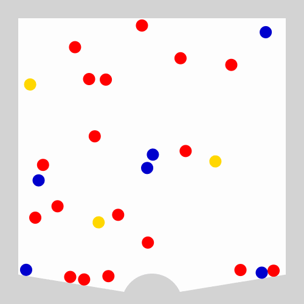

# bingo-blower.js
A virtual bingo-blower for ambiguity and risk experiments.



\* This is a recording: the real-time version in the [demo](https://geoffreycastillo.com/bingo-blower-js-demo/) looks better.

## Demo
https://geoffreycastillo.com/bingo-blower-js-demo/

## Installation
`bingo-blower.js` uses [`matter.js`](https://github.com/liabru/matter-js).
Include both, for example from [jsDelivr](https://www.jsdelivr.com/):
```html
<script src="https://cdn.jsdelivr.net/npm/matter-js@0.20.0/build/matter.min.js"></script>
<script src="https://cdn.jsdelivr.net/gh/geoffreycastillo/bingo-blower-js@v4.0.0/bingo-blower.min.js"></script>
```
Always pin the version (`@v4.0.0` above), so that a new release cannot change your experiment while it is running.
You can also download `bingo-blower.js` from the [releases](https://github.com/geoffreycastillo/bingo-blower-js/releases) and host it yourself.

## Quick start
```html
<canvas id="world"></canvas>
<button type="button" id="draw">Draw a ball</button>
The ball drawn is: <span id="result"></span>

<script src="https://cdn.jsdelivr.net/npm/matter-js@0.20.0/build/matter.min.js"></script>
<script src="https://cdn.jsdelivr.net/gh/geoffreycastillo/bingo-blower-js@v4.0.0/bingo-blower.min.js"></script>
<script>
    const blower = new BingoBlower();
    blower.addBalls([1, 2, 3]);
    const button = document.getElementById('draw');
    button.addEventListener('click', async () => {
        button.disabled = true;
        const draw = await blower.drawBall();
        document.getElementById('result').textContent = draw.label;
    });
</script>
```

See the [wiki](https://github.com/geoffreycastillo/bingo-blower-js/wiki) for advice on using `bingo-blower.js` in an experiment, including with oTree.

## Examples

Create a smaller bingo-blower, for example for phones: `new BingoBlower({width: 300})` (everything shrinks with it, and the balls move the same way)

Create a bingo-blower with bigger balls: `new BingoBlower({ballSize: 0.06})` (you will also need to increase `windForce` or decrease `density`, because bigger balls are heavier!)

Blur the bingo-blower for the first 3 seconds, so that the balls are harder to count: `new BingoBlower({revealSeconds: 3})`

Frost the edges of the bingo-blower, so that the balls there cannot be counted, even from a screenshot: `new BingoBlower({frostedEdges: true})`

Frost or unfrost the edges while the bingo-blower is running: `blower.addFrostedEdges()` and `blower.removeFrostedEdges()`

Add a lot of balls: `blower.addBalls([10, 15, 20, 25])`

Same number of balls but base64-encoded: `blower.addBalls('WzEwLDE1LDIwLDI1XQ==')`

Add balls in your own colours: `blower.addBalls([1, 2, 3], ['MediumVioletRed', 'HotPink', 'Pink'])`

Add numbered balls, red 1 to 10 and blue 1 to 10: `blower.addBalls([BingoBlower.range(1, 10), BingoBlower.range(1, 10)])`

Add numbered balls of a single colour, with repeated numbers: `blower.addBalls([[1, 1, 2, 7]], ['Red'])`

## API

### `new BingoBlower(options)`

Draws a bingo-blower on a canvas and starts the simulation.
All options are optional.

| Option | Default | Description |
| --- | --- | --- |
| `el` | `'world'` | Id of the canvas where the bingo-blower is drawn |
| `width` | `500` | Width and height of the bingo-blower in pixels, which is a square |
| `wallWidth` | `0.06` | Width of the walls, as a fraction of the bingo-blower's width |
| `ballSize` | `0.02` | Radius of the balls, as a fraction of the bingo-blower's width |
| `numberedBallSize` | `0.03` | Radius of the numbered balls, as a fraction of the bingo-blower's width |
| `density` | `0.004` | Density of the balls |
| `friction` | `0.02` | Friction of the balls |
| `frictionAir` | `0.001` | Air resistance of the balls |
| `frictionStatic` | `0.001` | How much force it takes to move a stationary ball |
| `restitution` | `0.7` | Bounciness of the balls |
| `windForce` | `9e-4` | How strong the air blows at the bottom of the blower |
| `targetColour` | `'LightGray'` | Colour of the target |
| `targetWidth` | `0.1` | Width of the target, as a fraction of the bingo-blower's width |
| `targetThickness` | `0.02` | Thickness of the target, as a fraction of the bingo-blower's width |
| `drawnBallHighlight` | `'Black'` | Colour of the ring around the ball drawn |
| `drawnBallThickness` | `0.25` | Thickness of the ring around the ball drawn, as a fraction of the ball's diameter. The ring sits outside the ball |
| `timeSeconds` | `3` | How long the balls keep tumbling after the target appears |
| `revealSeconds` | `0` | How long the blower takes to go from blurry to sharp (0 for no blur) |
| `frostedEdges` | `false` | Whether the edges of the blower start frosted, so that the balls there cannot be counted |
| `edgeBlur` | `0.12` | How much the frosted edges are blurred: roughly the size of the area each blurred pixel averages over, as a fraction of the bingo-blower's width |
| `edgeBand` | `0.44` | How much of the bingo-blower's width is frosted, split equally between both sides: 0.5 frosts a quarter from each side, 1 frosts everything |
| `edgeFrost` | `0.5` | How much the frosted edges are washed out to white, from 0 (not at all) to 1 (completely) |

Only `width` is in pixels.
Everything else scales with it, so a bingo-blower of any width looks and moves like the default one, only bigger or smaller.
`wallWidth`, `ballSize`, `numberedBallSize`, `targetWidth`, `targetThickness`, `drawnBallThickness`, `edgeBlur`, `edgeBand` and `edgeFrost` must be between 0 and 1, or `new BingoBlower()` throws an error.

See the [matter.js documentation](https://brm.io/matter-js/docs/classes/Body.html) for details on `density`, `friction`, `frictionAir`, `frictionStatic` and `restitution`.

`edgeBlur`, `edgeBand` and `edgeFrost` are only used when the edges are frosted.
Their defaults are the recommended setting: change them only if you want to fine-tune the frosted edges.
The walls, the target and the ball drawn are never frosted.

### `blower.addBalls(ballList, colours)`

Adds balls to the blower.
`ballList` gives, for each colour, either the number of balls or the numbers on the balls:

- `[1, 2, 3]` adds 1 red, 2 blue and 3 yellow balls, without numbers
- `[[1, 2], [1, 2, 3]]` adds red balls numbered 1 and 2, and blue balls numbered 1, 2 and 3

`ballList` can also be its base64-encoded JSON, e.g. `'WzEsMiwzXQ=='`.
`colours` is the CSS colour of each entry, and defaults to `['Red', 'MediumBlue', 'Gold', 'LimeGreen', 'Sienna']`.

A blower holds either numbered balls or balls without numbers, not both.
Adding the other kind throws an error, unless the blower is empty.

Numbered balls look like real bingo balls: the number is on a white disc in the middle of the ball.
Numbers that read as another number upside down are underlined, e.g. 6 and 9.
Numbered balls are bigger than the others, so that their numbers are easy to read: their size is `numberedBallSize`, not `ballSize`.
Their density is lowered so that they weigh the same as balls of size `ballSize`, so that the air lifts them the same way.

### `BingoBlower.range(from, to)`

Returns the numbers from `from` to `to`, both included, e.g. `BingoBlower.range(1, 5)` returns `[1, 2, 3, 4, 5]`.
Useful to number balls with `addBalls()`.

### `blower.removeBalls(ballList, colours)`

Removes balls from the blower. Same arguments as `addBalls()`.
A number of balls removes that many balls of that colour, numbered or not.
A list of numbers removes the balls of that colour with those numbers.

### `blower.drawBall()`

Shows the target, lets the balls tumble for `timeSeconds`, stops them, then highlights the ball closest to the target.
Returns a promise of the ball drawn, e.g. `{colour: 'MediumBlue', label: 'blue', number: 7}`, or of `null` if `reset()`, `destroy()` or another `drawBall()` was called during the draw.

The `label` is a human-readable colour: CSS colours ending in Red, Blue, Green, Yellow, Pink or Violet become that colour (e.g. 'MediumBlue' becomes 'blue'), 'Gold' becomes 'yellow' and 'Sienna' becomes 'brown'.
Any other colour is simply lowercased.

The `number` is the number on the ball, or `null` if the balls are not numbered.

### `blower.reset()`

Hides the target, removes the highlight and lets the balls move again. Cancels a draw in progress.

### `blower.addMouseControl()` and `blower.removeMouseControl()`

Lets the user drag the balls with the mouse or by touch, or stops them from doing so.
Mouse control is off by default.

Mouse control is locked from the start of `drawBall()` until `reset()`, so that the user cannot steer a ball onto the target.
`reset()` turns it back on if it was on before the draw.
Calling `addMouseControl()` while it is locked does nothing.

### `blower.addFrostedEdges()` and `blower.removeFrostedEdges()`

Frosts the edges of the blower, or removes the frosting, while it is running.
The `frostedEdges` option only sets whether the edges start frosted.
The frosting uses `edgeBlur`, `edgeBand` and `edgeFrost` from `new BingoBlower()`.

### `blower.destroy()`

Stops the simulation, so that a new bingo-blower can be created on the same canvas. Cancels a draw in progress.

## Limitations

`bingo-blower.js` needs a browser from 2021 or later (Chrome 84, Firefox 90, Safari 15).
On devices too slow to keep up, the balls will move slower.
The [wiki](https://github.com/geoffreycastillo/bingo-blower-js/wiki) explains how to record participants' browser and frame rate.

## Citation

If you use `bingo-blower.js`, please cite our paper: [Andersson, Castillo and Wengström, "Generating ambiguity with a virtual bingo blower"](https://geoffreycastillo.com/pdf/Andersson,Castillo,Wengstroem-Generating-ambiguity-with-a-virtual-bingo-blower.pdf)

## Bugs? Suggestions?

[Open an issue](https://github.com/geoffreycastillo/bingo-blower-js/issues) or a [pull request](https://github.com/geoffreycastillo/bingo-blower-js/pulls), or email me at [`geoffrey.castillo@ntu.ac.uk`](mailto:geoffrey.castillo@ntu.ac.uk).

## Licence

`bingo-blower.js` is licensed under the [GNU General Public License v3.0](https://www.gnu.org/licenses/gpl-3.0.en.html).

Copyright (c) 2022-2026 Geoffrey Castillo
